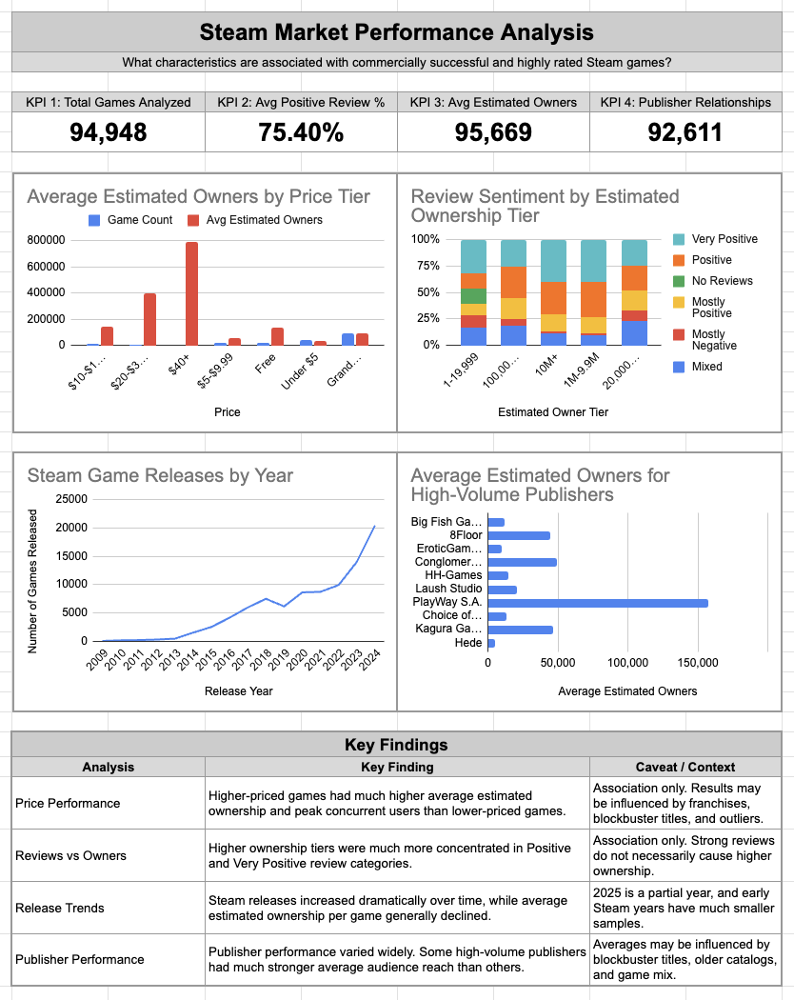

# Steam Game Market Analysis

**An Excel and Python portfolio project by Tiffany Hipple**

What patterns connect game pricing, review sentiment, release timing, and estimated audience size on Steam?

I analyzed **94,948 Steam application records**, using Python and pandas to profile, validate, and prepare the data, then spreadsheet lookups, calculated categories, PivotTables, and charts to explore the results. The completed deliverable is a spreadsheet dashboard and supporting analysis.



**Explore:** [Download the workbook](../../raw/HEAD/reports/steam_game_analysis.xlsx) · [View the dashboard](reports/steam_summary_dashboard.png) · [Read the findings](docs/findings.md) · [Review the methodology](docs/methodology.md)

## Results at a glance

| Metric | Result | Definition |
| --- | ---: | --- |
| Application records analyzed | 94,948 | Distinct, nonmissing `appid` values |
| Average positive-review percentage | 75.40% | Unweighted mean of calculated per-record percentages, excluding records with no calculated reviews |
| Average estimated owners | 95,669 | Mean of ownership-range midpoints, rounded |
| Publisher relationships | 92,611 | Unique application–publisher pairs; not a count of publishers |

These headline values were independently recalculated from the committed CSVs.

## Main findings

- **Higher price tiers had higher average estimated ownership.** The $40+ group averaged about 788,452 estimated owners, compared with 36,983 for games priced above $0 and below $5. Price alone does not explain the difference.
- **Release volume increased sharply.** The dataset contains 1,529 releases in 2014 and 20,427 in 2024. Average ownership midpoints for those cohorts were approximately 321,000 and 36,565, respectively. Newer releases have had less time to accumulate owners.
- **The workbook shows stronger review sentiment in the largest ownership tiers.** This is a descriptive association and does not establish that reviews cause higher ownership.
- **Publisher averages vary substantially.** Catalog size and blockbuster titles affect comparisons. A game with multiple publishers contributes to each publisher's group.

See [findings and interpretation](docs/findings.md) for the supporting numbers and limits.

## My work

1. Profiled the dataset and established one row per Steam application ID. Repeated titles were retained when their IDs differed.
2. Investigated missing values, sentinel codes, extreme values, and disagreements between review fields.
3. Converted unavailable values to null, parsed ownership ranges, and calculated review metrics without overwriting source review fields.
4. Exported separate metrics and lookup tables and built a deduplicated publisher bridge.
5. Built spreadsheet lookups, analysis categories, four pivot-based analyses, charts, and a Summary dashboard.
6. Documented findings, data-quality decisions, and interpretation limits.

**Skills demonstrated:** Python, pandas, data profiling, cleaning, relational joins, spreadsheet formulas, PivotTables, visualization, QA, and communicating findings.

## Repository guide

| Location | Contents |
| --- | --- |
| `reports/steam_game_analysis.xlsx` | Completed workbook, including Summary, analysis, formula notes, and dictionary tabs |
| `reports/steam_summary_dashboard.png` | Dashboard preview viewable without spreadsheet software |
| `data/excel/` | Prepared game metrics, lookup, and publisher relationship CSVs |
| `scripts/01` through `05` | Original profiling, validation, cleaning, and export workflow |
| `scripts/06_validate_exports.py` | Runnable checks and independently calculated summary tables |
| `outputs/data_quality/` | Original QA log and cleaning decisions |
| `outputs/analysis/` | Recalculated KPIs and supporting result tables |
| `docs/` | Findings, methodology, data dictionary, and workbook review notes |

## Run the validation

Python 3.10 or later is recommended. From the repository root:

```bash
python -m venv .venv
source .venv/bin/activate
python -m pip install -r requirements.txt
python scripts/06_validate_exports.py
```

On Windows, activate the environment with `.venv\Scripts\activate` instead. The validation works with the included CSVs and does not need the original raw dataset or spreadsheet software. It exits with an error if a checked invariant fails and writes summary tables to `outputs/analysis/` after successful validation.

To follow the original source-to-export workflow, see [reproduction instructions](docs/methodology.md#reproducing-the-workflow).

## Important context

The original workflow references `games_march2025_full.csv`. The raw dataset, original download URL, and upstream license are not included in this repository. The analysis describes a historical dataset rather than current Steam activity. Ownership is estimated, not sales or revenue. The unit of analysis is an application record, which can include multiple records sharing a title.

The workbook was exported from a spreadsheet workflow containing Google Sheets functions. Excel compatibility and refresh behavior have not been fully verified. A review also identified a mismatch between some workbook fields labeled `peak_ccu` and the committed CSV field. **Use the CSV field for concurrency analysis; this write-up makes no conclusions from the workbook's concurrency calculations.** Details are in [workbook review notes](docs/workbook_review.md).
